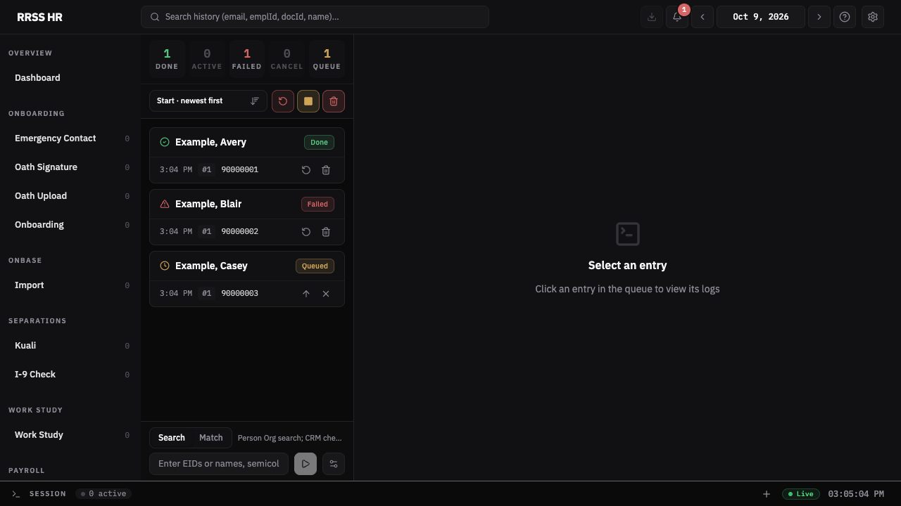

# HR Automation

A local HR operations dashboard built for a UCSD HR team. Playwright-driven workflows cover onboarding, separations, person lookup, work-study updates, oath signatures, oath uploads, emergency contacts, and timekeeping reports. A durable task queue, progress logs, document review, and explicit approval steps keep the operator involved. This is not an official UCSD product.

## Try the mock dashboard

Use Node 26 or later and npm 11 or later:

```sh
npm ci
npm run demo
```

Open **http://127.0.0.1:3939**. This renders the production dashboard against a fresh temporary tracker containing only synthetic people. The preview permits a fixed set of read routes and rejects workflow starts, uploads, settings changes, browser controls, and access to operator files. It requires no `.env`, credentials, enrolled Duo key, or UCSD connection. It is a read-only preview; it does not simulate transaction submission or OCR.



## Keep operational data local

Keep operator data in `data/`, runtime state in `.tracker/`, credentials in `.env` and `.auth/`, and machine settings in `config/settings.json`. These paths are ignored. The optional private `duo-autopilot/` checkout and local `.agents/`, `.claude/`, and `.codex/` tools are also ignored. They can remain on your machine. Public changes do not require deleting your local files or changing the production system drivers.

Fixtures use manufactured names and example email domains. The mock preview uses `900000xx` IDs. Validation fixtures also use documented synthetic `10xxxxxx` values because production UCPath validation requires that shape. These fixture IDs must never be used as live employee inputs.

Read [the local data and publication contract](docs/engineering/publication.md) before preparing a release. Written UCSD supervisor approval and the operator's final review precede any upload or visibility change.

## Setup

```bash
npm install
npx playwright install chromium
cp .env.example .env   # fill in credentials
npm run setup          # validates environment
```

### Environment Variables

| Variable | Description |
|----------|-------------|
| `UCPATH_USER_ID` | UCSD SSO username |
| `UCPATH_PASSWORD` | UCSD SSO password |
| `TIMEKEEPER_NAME` | Operator timekeeper name required when a workflow fills the Kuali timekeeper field |

Duo MFA is manual — the automation pauses and polls until you approve on your phone.

## Commands

Workflow starts are dashboard-only: typed runs use the top input bar and file/PDF runs use the upload modal. Daemon workers still back most workflows; use `:stop` scripts to drain and shut down a workflow's daemon pool.

### Daemon Stops
```bash
npm run onboarding:stop                      # Soft-stop all onboarding daemons
npm run separation:stop                      # Soft-stop all separation daemons
npm run work-study:stop
npm run person-lookup:stop                   # Person Lookup replaces legacy eid-lookup + active-check starts
npm run oath-signature:stop
npm run oath-upload:stop
npm run emergency-contact:stop
npm run crm-doc-download:stop
```

### Dashboard
```bash
npm run dashboard                            # SSE backend (:3838) + Vite dev (:5173) + ngrok for phone Capture QR links
npm run dashboard:watch                      # Same, but tsx watch restarts SSE backend on src/ changes
npm run dashboard:prod                       # Serve pre-built dashboard from SSE only
```

Open **http://localhost:5173** to monitor live workflow progress. Capture
QR links require a public URL (set `CAPTURE_PUBLIC_URL` when running ngrok
separately, or pass `--capture-ngrok`). Capture does not use LAN QR fallbacks;
a dashboard started without `CAPTURE_PUBLIC_URL` or `--capture-ngrok` still
boots — Capture is disabled and `/api/capture/start` returns 503 until a public
URL is provided.

### Export / Utilities
```bash
tsx --env-file=.env src/cli.ts export <workflow>   # Dump JSONL tracker to xlsx
npm run clean:tracker                              # Default 7d: prune stale .tracker JSONL and .tracker/screenshots PNGs (`--days`, `--dir`, `--no-screenshots`, `--screenshots-only` — see `src/scripts/ops/clean-tracker.ts`)
npm run test-login                                 # Smoke test UCPath + CRM auth
npm run setup                                      # First-use environment validation wizard
npm run schemas:export                             # Write each workflow's Zod input schema as JSON Schema
npm run selectors:catalog                          # Regenerate per-system SELECTORS.md
npm run selector:search "<intent>"                 # Fuzzy search across SELECTORS.md + LESSONS.md
npm run typecheck                                  # Type-check src/
npm run typecheck:all                              # Type-check src/ + tests
npm run lint                                       # ESLint
npm run test                                       # Unit tests
npm run test:architecture                          # Static architecture/convention guards
npm run build:dashboard                            # Single-file dashboard build
```

> If `npm run` is blocked, invoke tsx directly: `./node_modules/.bin/tsx --env-file=.env src/cli.ts <command>`

## Architecture

See `CLAUDE.md` for the full architecture reference, kernel API, daemon mode design, and workflow authoring guide.

```
src/
  core/          # Workflow kernel (kernel/, daemon/, task-store/)
  systems/       # Playwright drivers: crm, ucpath, i9, kuali, old-kronos, new-kronos, servicenow, sharepoint
  workflows/     # Composed workflows: onboarding, separations, person-lookup, work-study,
                 #   oath-signature, oath-upload, emergency-contact, ocr, old-kronos-reports,
                 #   sharepoint-download, crm-doc-download
  infra/         # Auth flows + browser launch
  services/      # OCR, roster matching, mobile photo capture,
                 #   timecard/ — shared UKG/timecard helpers (`src/services/timecard/`)
  tracker/       # JSONL append + SSE + Excel export
  dashboard/     # React SPA (Vite + shadcn/ui)
  domain/        # Pure HR business logic (identity, names, EIDs, etc.)
  utils/         # log, errors, env
  cli.ts         # Commander entry point
  config.ts      # URLs, PATHS, TIMEOUTS, SCREEN, ANNUAL_DATES
```

## How It Works

All workflows run headed Chromium browsers so you can approve Duo MFA prompts. In **daemon mode**, browsers stay open between items — Duo fires once per daemon spawn, not per item. Subsequent enqueues claim work from a shared SQLite queue without re-authentication.

### Selector Discovery

```bash
npm install -g @playwright/cli@latest
playwright-cli -s=mysession open --headed "<url>"
playwright-cli -s=mysession snapshot    # accessibility tree with ref IDs
playwright-cli -s=mysession click e40   # interact by ref
```

After mapping, add to `src/systems/<system>/selectors.ts` with `// verified YYYY-MM-DD`. Run `npm run selectors:catalog` to sync.
